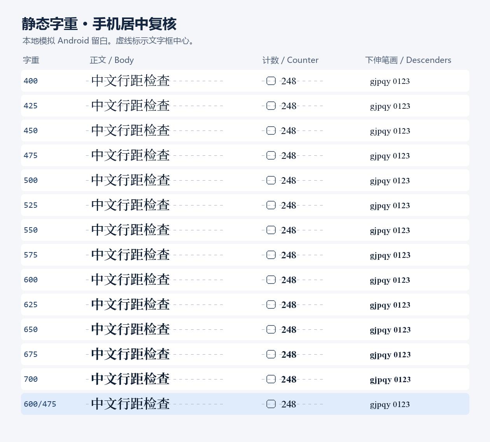

# 居中复核 / Mobile alignment audit

2026-11-19 · FontTools 4.62.1、FreeType、Pillow

复核覆盖 400–700 每 25 一档的 13 个静态字体和 600/475 特调静态版。所有文件按校验和回读，均覆盖 33,033 个 Unicode 码位。常用汉字、常见标点和可打印 ASCII 在本次检查中均落在行度量范围内。

The review covers 13 static weights from 400 to 700 in steps of 25 and the custom 600/475 static build. Each file passed checksum validation and maps 33,033 Unicode code points. The checked Han, punctuation, and printable ASCII outlines fit the line metrics.

| 字重 Weight | 抽查轮廓 yMin–yMax | 汉字最大偏移 Max Han offset | 数字最大偏移 Max digit offset |
| --- | ---: | ---: | ---: |
| 400 | −216…864 | 1.0 px | 1.0 px |
| 425 | −216…865 | 1.0 px | 1.0 px |
| 450 | −216…865 | 1.0 px | 0.5 px |
| 475 | −216…866 | 1.0 px | 0.5 px |
| 500 | −216…866 | 1.0 px | 0.5 px |
| 525 | −216…867 | 0.5 px | 0.5 px |
| 550 | −216…867 | 0.5 px | 1.0 px |
| 575 | −216…868 | 0.5 px | 1.0 px |
| 600 | −216…868 | 1.0 px | 1.0 px |
| 625 | −216…869 | 0.5 px | 1.0 px |
| 650 | −217…870 | 0.5 px | 1.0 px |
| 675 | −220…871 | 0.5 px | 1.0 px |
| 700 | −222…872 | 0.5 px | 1.0 px |
| **600/475** | −216…868 | 1.0 px | 0.5 px |

偏移为本地 Android 留白模型中，22、26、34 px 的汉字和计数试样可见轮廓中心到文字框中心的最大距离。所有静态档的 `head` 纵向边界为 −230 至 960，`hhea` 为 880 / −230 / 0，与此前通过手机视觉检查的静态居中版一致。13 个静态档本轮在本机通过复核。600/475 特调版另有作者手机端的基本视觉检查。

Offsets are the largest distances between the visible sample center and the text box center at 22, 26, and 34 px in the local Android padding model. All static builds use vertical `head` bounds of −230 to 960 and `hhea` metrics of 880 / −230 / 0, matching the earlier static build verified on a phone. The 13 static weights passed the local recheck. The author also completed a basic phone check of the custom 600/475 build.

## 可变原型 / Variable prototype

可变原型在作者的手机上仍出现上方留白过大的情况。以 FontTools 将该原型固定在 550 并保存，默认的自动边界重算会把 `head` 从 −230 / 960 改为 −547 / 2111。关闭重算时，原边界可保留。这复现了可能导致偏移的机制。手机换字体工具的处理方式尚未确认。

The variable prototype still showed excess top padding on the author's phone. Saving a FontTools instance at weight 550 with automatic bounding-box recalculation changed `head` from −230 / 960 to −547 / 2111. Disabling recalculation preserved the original bounds. This reproduces a possible cause of the shift. The behavior of the phone's font installation tool has yet to be confirmed.

[Android 文本排版实现 / Android layout source](https://android.googlesource.com/platform/frameworks/base.git/+/master/core/java/android/text/StaticLayout.java)
