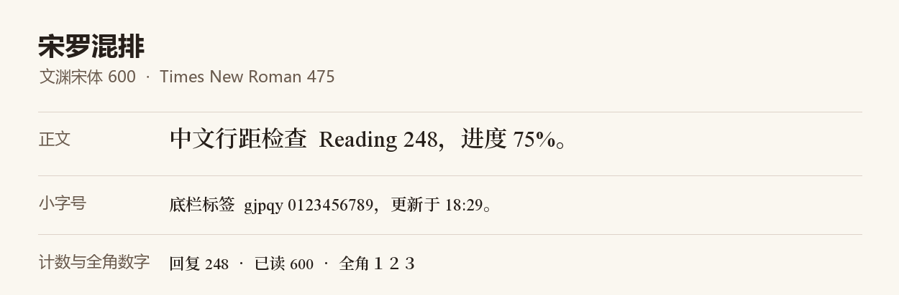

# 文渊宋+新罗马混排字体

**WenYuan Roman** 是一组面向手机显示的中西文混排试样。中文、中文标点和全角数字来自文渊宋体，半角英文和数字来自 Times New Roman。

## 📱 手机试用记录

- **600/475 特调版**为静态设计，中文用 600，西文用 475。作者在手机上完成了基本视觉检查。
- **13 个静态字重**覆盖 400–700，每 25 一档。逐档复核了汉字、计数与小字号下伸笔画，以及与静态居中版一致的纵向度量。
- **400–700 可变原型**在手机实测中仍出现上方留白过大的情况。查看[居中复核报告](CHECKS.md)中的复现条件和测试范围。

如有需要，可以私信联系仓库作者。

## 🖼️ 测试图

[13 档字重对照](images/weight-series.png) · [静态档居中检查图](images/mobile-alignment-check.png) · [逐档验收结果](CHECKS.md)

本仓库公开测试图、说明和验收结果。文渊宋体及 Times New Roman 的授权以各自来源为准。 [文渊宋体授权](https://github.com/takushun-wu/WenYuanFonts/blob/main/LICENSE.md) · [Microsoft 字体再分发说明](https://learn.microsoft.com/en-us/typography/fonts/font-faq)

## English

**WenYuan Roman** documents a mobile typography experiment using WenYuan Serif for Chinese text and Times New Roman for half-width Latin letters and digits.

- The **custom 600/475 static build** pairs Chinese at 600 with Latin at 475. The author completed a basic visual check on a phone.
- All **13 static weights**, 400 through 700 in steps of 25, were checked locally for vertical metrics, centered Han and numeral samples, and room for descenders.
- The **400–700 variable prototype** showed excess top padding in the phone test. See the [alignment audit](CHECKS.md) for the reproduction and its limits.

If you have a question about the project, feel free to contact the repository author privately.

This repository shares the specimens, documentation, and test results. The typefaces retain their respective licensing terms. [WenYuan Serif license](https://github.com/takushun-wu/WenYuanFonts/blob/main/LICENSE.md) · [Microsoft font redistribution FAQ](https://learn.microsoft.com/en-us/typography/fonts/font-faq)
